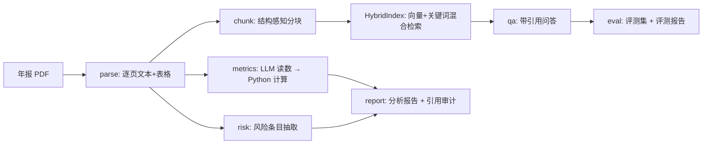

# Annual-Report-Analyst · AI 年报解读与风险提示

AI × 传统行业（财务/证券）项目：把上市公司年报 PDF 变成**带页码引用的结构化分析**——
财务指标自动计算、风险条目抽取、可溯源问答，并内置一套可迭代的评测体系。

> 免责声明：所有输出仅供学习研究，不构成投资建议。

## 为什么值得做

- 年报动辄 200+ 页，散户与初级分析师需要快速定位关键数字与风险段落，痛点真实；
- 这是 **token 密集型**项目：长文档解析、评测回归、评测集构建——预算能花在刀刃上；
- 工程深度集中在三块：复杂 PDF 解析、引用可溯源（幻觉控制）、评测体系。

## 核心设计

| 设计决策 | 做法 | 为什么 |
| --- | --- | --- |
| LLM 只读数，本地算指标 | LLM 从"主要会计数据"抽取科目数值；同比/净利率等全部由 Python 计算 | 计算可审计、可单测，杜绝模型"心算"错误 |
| 强制引用 | 报告与问答中每个论断必须 `(p.页码)`，页码只能取自材料标注 | 可机械验证的幻觉控制 |
| 评测先行 | `build_eval` 出题 → 人工复核 → `run_eval` 跑引用有效率 + LLM-as-judge | 改 prompt/分块/检索策略时有回归基线 |
| 零成本降级 | 未配置 embedding API 时，检索自动退化为"字符 bigram + idf 加权"关键词模式 | 无 key 也能跑通解析、检索与整条评测链路 |

## 架构



## 快速开始

```bash
cd annual-report-analyst
python -m venv .venv && source .venv/Scripts/activate   # Windows Git Bash
pip install -r requirements.txt
pip install -e .
cp .env.example .env    # 填入 LLM_API_KEY（默认智谱 GLM，可换任意 OpenAI 兼容接口）
```

年报 PDF 建议用自带脚本从巨潮资讯网下载（也可手动下载后放入 `data/raw/`）：

```bash
python scripts/fetch_report.py 600519 --year 2023   # 自动检索并下载全文 PDF
```

```bash
# 1) 解析 + 建索引（会调用 embedding 接口）
python -m report_analyst parse data/raw/600519_2023.pdf

# 2) 生成分析报告（指标计算 + 风险扫描 + 带引用报告）
python -m report_analyst analyze data/raw/600519_2023.pdf

# 3) 针对年报问答（自动检索、附页码引用）
python -m report_analyst ask data/raw/600519_2023.pdf "本期研发投入是多少？同比变化如何？"
```

## 评测体系（token 大头花在这里）

> **多语料评测已完成：5 家公司 × 106 题**（茅台/万科/美的/招行/宁德，2023 年报），持续改进闭环：
> - 满分率 **73.6% → 78.3% → 80.2%**（表格感知分块 → 本地语义检索 + 两道自愈防线）；
> - **引用有效率 100%**、保守拒答 15 → 6 题、数字审计告警仅 1 且与裁判判 0 一致；
> - 语义检索用本地 fastembed（bge-small-zh，CPU 12-31 秒/份），**无需任何 API**；
> - 亮点数据：万科明细表格题 +15.8pp；茅台 100%；银行年报仍是硬骨头（57~67%）。
> 详见 [docs/评测报告.md](docs/评测报告.md)：9 个真实数据暴露并修复的工程问题、
> 出题复核记录、四种配置的失败画像对比与两轮被数据验证的改进闭环。

```bash
# 1) LLM 辅助出题
python scripts/build_eval.py 600519_2023 --n 30

# 2) 人工复核 data/eval/qa_600519_2023.jsonl，把正确的题 reviewed 改为 true

# 3) 跑评测：引用有效率（规则，零成本）+ 回答正确率（LLM-as-judge）
python scripts/run_eval.py 600519_2023
```

- **grounding_rate**：回答中 `(p.N)` 引用的页码是否全部落在检索证据页范围内；
- **accuracy**：LLM-as-judge 按 0/1/2 打分。

每次修改 prompt、分块策略或检索参数后重跑评测，把结果 JSON 留档——
评测曲线本身就是这个 repo 最有说服力的部分。

## Token 预算建议（单份年报量级）

| 用途 | 量级 | 优先级 |
| --- | --- | --- |
| 解析 + 建索引（embedding） | ~50 万 | 必要 |
| 报告生成 | ~5 万 | 必要 |
| 评测集构建 + 复核迭代 | ~100 万 | 高 |
| 评测回归（50 题 × 20 轮迭代） | ~2000 万 | 高，质量提升的核心 |
| 扫描件 OCR 对比实验 | 灵活 | 低 |

开发调试用便宜模型（如 glm-4.5-flash），评测与最终生成用旗舰模型，配置见 `.env`。

## Roadmap

- [ ] 扫描件支持：PaddleOCR 预处理（真实扫描件是最大的脏数据挑战）
- [ ] 三大报表深度解析：毛利率、ROE 杜邦分解
- [ ] 多期对比：3-5 年趋势分析
- [ ] Web UI + 一键部署 demo
- [ ] MCP server：让任意 IDE / Agent 调用年报问答

## 目录结构

```
annual-report-analyst/
├── src/report_analyst/
│   ├── config.py        # 环境变量配置
│   ├── llm.py           # chat / chat_json / embed（任意 OpenAI 兼容接口）
│   ├── parse.py         # PDF → 逐页文本+表格 JSON
│   ├── index.py         # 结构感知分块 + 混合检索
│   ├── metrics.py       # 科目抽取（LLM）+ 指标计算（纯 Python）
│   ├── risk.py          # 风险条目抽取
│   ├── report.py        # 带引用的分析报告生成 + 引用审计
│   ├── qa.py            # 带引用问答
│   └── cli.py           # parse / analyze / ask
├── scripts/
│   ├── build_eval.py    # LLM 辅助出题 → 评测集
│   └── run_eval.py      # 引用有效率 + LLM-as-judge 评测
├── tests/               # 指标计算 / 分块规则 / 数字审计的单元测试
└── data/{raw,parsed,reports,eval}/
```
